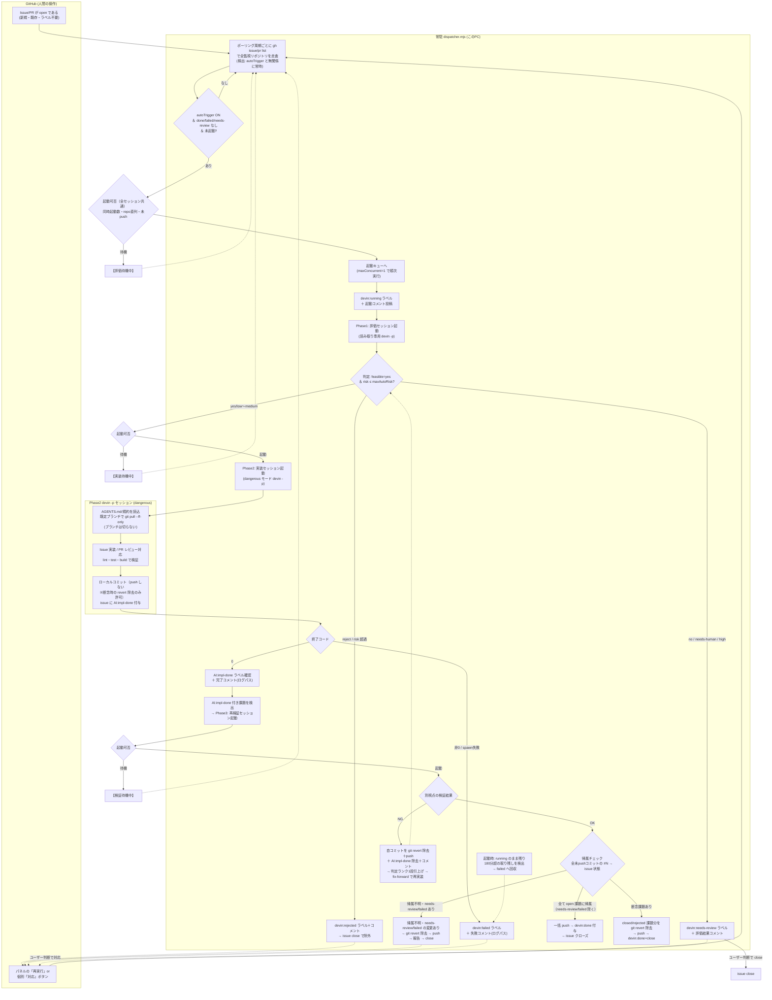
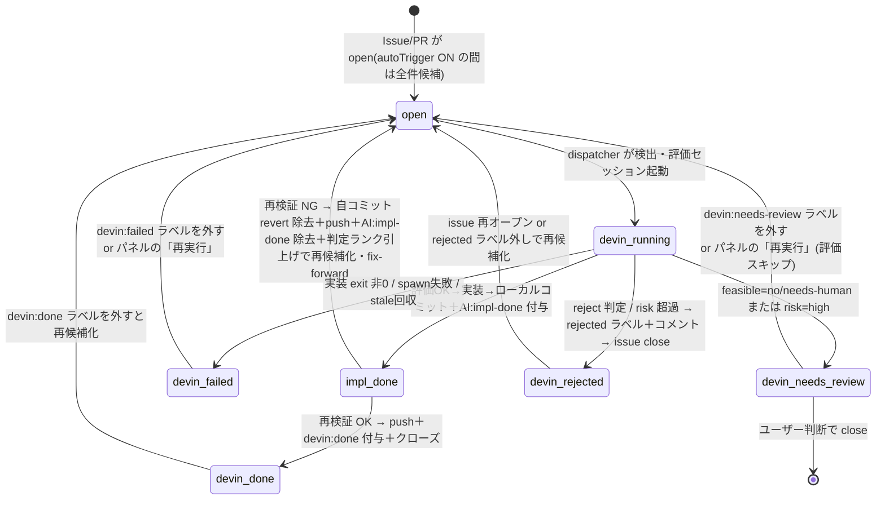

# Devin Agent Dispatcher

GitHub Issues/PR を監視する常駐システム。**「対応候補の検出」と「自動処理（起動）」は
独立した2つの機能**として動く。この PC（`C:\devin`）上で動作する。

- **対応候補（検出）= `autoDiscover`**: ON の間、全 open Issue/PR を定期スキャンし
  `candidates.json` に保存。OFF なら自動検出を停止（「今すぐ取得」での手動更新は可）
- **課題対応（起動）= `autoTrigger`**: ON の間だけ、検出した候補を評価→実装の
| `autoTriggerMode` | `all` | 自動処理の起票者ゲート。`all`=全起票者（現行動作）/ `trusted`=`trustedAuthors`・repo オーナー・collaborator のみ自動起動（他は候補表示のみで手動 dispatch/ラベルで起動可）|
| `autoIssueOnFailure` | `false` | ワークフロー失敗・dispatcher 自己異常の自動 Issue 起票（failure-watch）。既定 OFF・明示有効化のみ |
| `failureDedupeHours` | `24` | failure-watch の dedupe キー（repo+workflow / self:error）の再抑制時間 |
| `trustedAuthors` | `[]` | `autoTriggerMode:trusted` 時に信頼済みとみなす起票者ログイン名の配列 |
  2フェーズで自動起動する。OFF でも検出・一覧・手動起動は動く
- パネル最上段の2つのトグルで独立制御。「取得だけ自動・処理は手動」も可能
- トリガーにラベルは不要。除外したい課題には `devin:done` ラベルを付ける



ラベル状態遷移（Issue/PR 側から見た図）:



## 前提（初回のみ）

1. **devin CLI のログイン**（必須・未実施の場合）
   ```
   "C:\Users\ryu.RYU-NOTE\AppData\Local\Programs\Devin\resources\app\extensions\windsurf\devin\bin\devin.exe" auth login
   ```
   ※ `devin` は PATH に無いため上記フルパス。任意で bin フォルダを PATH に追加してよい。
2. `gh auth login` 済みであること（この環境では済）
3. Node.js v18+（この環境では v24）

## 使い方

### 管理パネル（推奨）

```bash
cd C:\devin\agent
node control.mjs    # http://127.0.0.1:8585/ に管理パネルが立つ
```

ブラウザで開くと **起動 / 停止 / 1サイクル実行 / 設定再読込** のボタン操作、
稼働状態・設定・**対応候補一覧**・処理履歴・ログのライブ表示ができる。

- **対応候補一覧**: `/api/candidates` が「次のポーリングで起動される課題」を表示。
  **2層のローカルキャッシュ**で GitHub への読込を最小化している:
  - `candidates.json` — 候補一覧のキャッシュ（`candidateCacheSec` 以内ならライブ取得をスキップ）
  - `issues.json` — 検出した課題の**詳細（body/labels/日時）のローカルストア**。
    手動 dispatch(`--task`) はここを優先して読み、`gh` 再取得しない
  - 「課題の有無」の検出自体は常にライブ取得（新規課題はキャッシュでは分からないため）。
    ただし GitHub Search API 横断クエリで **repo別18呼出→type別2呼出** に削減済み
- **個別「対応」ボタン**: 候補行のボタンで `POST /api/dispatch` →
  `dispatcher.mjs --task "owner/repo issue#N"` が単一課題だけを即時起動
  （ポーリングを待たない・他課題は起動しない）。`devin:running` 付きは二重起動防止で
  スキップ。処理履歴の failed 行には「再実行」ボタンも出る

- `control.mjs` が dispatcher の**親（スーパーバイザー）**。常駐・タスクスケジューラ登録するのはこちら
- 「起動」すると `desired.json` に `enabled:true` が残るため、PC 再起動後も
  control 起動と同時に dispatcher が自動復帰する。「停止」で `enabled:false`
- POST API は `X-Panel: 1` ヘッダ必須（CSRF対策）＋ `127.0.0.1` のみにバインド
- `/api/reload` は `config.json` のみ再読込。`.mjs` ファイルを編集した場合は
  control サーバー自体の再起動が必要（モジュールは起動時に読み込まれる）
- **開き方は3通り**: `http://127.0.0.1:8585/` / `panel.html` を `file://` で直接開く
  （CORS で `Origin:null` のみ許可済み）/ ターミナルから `curl` で API 直接操作

### ターミナルからの制御（curl）

```powershell
curl.exe http://127.0.0.1:8585/api/status                          # 状態確認
curl.exe http://127.0.0.1:8585/api/candidates                      # 対応候補一覧
curl.exe -X POST -H "X-Panel: 1" http://127.0.0.1:8585/api/start   # 起動
curl.exe -X POST -H "X-Panel: 1" http://127.0.0.1:8585/api/stop    # 停止
curl.exe -X POST -H "X-Panel: 1" http://127.0.0.1:8585/api/once    # 1サイクル実行
curl.exe -X POST -H "X-Panel: 1" http://127.0.0.1:8585/api/reload  # 設定再読込
curl.exe -X POST -H "X-Panel: 1" -d "{\"key\":\"yamamoto-ryuzo/portal issue#21\"}" \
         http://127.0.0.1:8585/api/dispatch                       # 個別課題を即時起動
```

### AI エージェントからの操作（API 仕様）

外部 AI・ツールから dispatcher を操作する受け口は3系統ある:

1. **HTTP MCP（`POST http://127.0.0.1:8585/mcp`・Streamable HTTP）— 推奨**。`initialize`/`tools/list`/`tools/call` を実装し、管理系ツール（`status`/`candidates`/`dispatch`/`chat_task`/`chat_send`/`kill`/`issue_create` 等26種）を公開。`tools/call` は `/api/*` への内部プロキシで検証ロジックは API と共通。書き込み系は MCP annotations（`readOnlyHint:false`・`destructiveHint`）でマーキング済み。**X-Panel は不要**（application/json POST は preflight 必須のため CORS で外部オリジンを遮断済み）。KASUGAI Canvas は mcp.js の内蔵サーバー `agent` として自動登録・自動接続される。任意の MCP クライアントから `{url: "http://127.0.0.1:8585/mcp"}` で接続可能
2. **HTTP API（`127.0.0.1:8585`）** — 直接叩ける経路。POST は `X-Panel: 1` ヘッダ必須
3. **MCP（stdio・`mcp-server.mjs`＝`issue-queue`）** — Devin IDE エージェント向け pull 型（`queue_list`/`queue_claim`/`queue_done`）。課題の引受専用で管理系は含まない

HTTP API 一覧（POST は `X-Panel: 1` 必須）:

| メソッド | パス | 用途 |
|---|---|---|
| GET | `/api/status` | 稼働状態・設定・最近タスク・実行中セッション |
| GET | `/api/events` | SSE: `state.json`/`candidates.json`/`issues.json`/`desired.json` の変化を push（パネルの即時反映用。`fs.watch`＋400ms デバウンス・自動再接続） |
| GET | `/api/candidates` | 対応候補一覧（`?force=1` でキャッシュ無視） |
| GET | `/api/metrics?days=7` | state.json tasks の期間集計（assess/impl/verify 件数・判定分布・所要時間。パネル「処理履歴」タブで表示） |
| GET | `/api/log?n=50` | dispatcher ログ末尾 |
| GET | `/api/chat?id=N`・`/api/chat/sessions` | チャットセッション履歴・一覧 |
| GET | `/api/skills`・`/api/prompts` | skills/*.md（enabled 付き）・prompts/*.md の一覧（読み取り専用） |
| POST | `/api/start` `/api/stop` `/api/once` `/api/reload` | ループ起停・1サイクル・設定再読込 |
| POST | `/api/dispatch` `{key}`・`/api/assess` `{key}` | 課題を作業キューへ登録（MCP pull 型） |
| POST | `/api/chat/task` `{key,mode,skill?,engine?}` | 課題をエンジンセッションで即時実行（assess/impl/split） |
| POST | `/api/chat/send` `{text,id?}` | 内蔵チャットへ自由文送信（任意指示の実行） |
| POST | `/api/chat/cancel|clear|reset|close` `{id}` | セッション操作 |
| POST | `/api/steer` `{key,text}`・`/api/kill` `{key}` | 実行中セッションへ追加入力・停止 |
| POST | `/api/issue` `{repo,title,body}`・`/api/close` `{key}` | Issue 起票・クローズ |
| POST | `/api/verdict` `{key,category}` | 評価カテゴリ手動上書き |
| POST | `/api/config` `{...}` | config.json の許可キー更新 |
| POST | `/api/assess-all`・`/api/impl-all` | 候補一括評価・一括対応 |

CORS: `Origin` が `null`(file://)・自オリジン・**ループバック任意ポート**
（localhost/127.0.0.1/[::1]）・`https://yamamoto-ryuzo.github.io`（CDN ホスト版）
の場合のみ許可。preflight は `Access-Control-Allow-Private-Network: true` を返す
ため public→private（CDN→localhost）アクセスも通る。それ以外のオリジンは
403/ACAO 無しでブラウザからブロックされる。

### CLI 直接起動（開発・検証用）

```bash
node dispatcher.mjs --dry-run   # 対象課題の検出のみ（起動しない・ラベルも作らない）
node dispatcher.mjs --once      # 1サイクル実行（見つけた課題は実際に起動）
node dispatcher.mjs             # 常駐ループ（管理パネル経由と同じ。どちらか一方で使う）
```

open な Issue/PR はすべて自動的に対応候補として検出される（ラベル不要）。
自動起動させるにはパネルの「自動処理」を ON にする。特定の課題だけ即時処理したい
場合は候補行の「対応」ボタン（評価フェーズはスキップ）。
除外したい課題にはあらかじめ `devin:done` ラベルを付けておく。

## 常駐化（タスクスケジューラ）

```powershell
powershell -ExecutionPolicy Bypass -File register-task.ps1   # control.mjs のログオン自動起動を登録
Start-ScheduledTask -TaskName DevinAgentDispatcher           # 今すぐ起動
```

登録されるのは `control.mjs`（管理サーバー）。パネルで「起動」した状態のままなら
`desired.json` により dispatcher も自動で上がる。パネルは常時 `http://127.0.0.1:8585/` で操作可能。

解除は `register-task.ps1 -Remove`。PC がシャットダウン中は動かない
（完全無人運用なら Devin Cloud Automations 構成を検討）。

## 設定（config.json）

| キー | 既定 | 説明 |
|---|---|---|
| `devinExe` | Devin Desktop 同梱 exe | devin CLI のパス |
| `pollIntervalSec` | 120 | ポーリング間隔（秒） |
| `maxConcurrent` | 1 | 同時起動セッション数 |
| `triggerLabel` 他 | `devin` / `devin:running` / `devin:done` / `devin:failed` | 状態ラベル（初回起動時に各 repo へ自動作成） |
| `autoDiscover` | `true` | `true` なら全 open Issue/PR を定期検出して `candidates.json` を更新 |
| `autoTrigger` | `true` | `true` なら検出した候補を自動起動（評価→実装）。検出自体は `autoDiscover` 側 |
| `autoTriggerSince` | `"all"` | 自動トリガーの起点。`"all"`=全 open Issue/PR が対象 / ISO8601時刻=それ以降の作成のみ / `null` なら dispatcher 初回起動時刻（`deployedAt`）以降のみ |
| `maxNewPerPoll` | 50 | 1ポーリングで自動起動キューに乗せる新規課題の上限（`autoTriggerSince:"all"` で backlog が全候補の場合でも `maxConcurrent` による直列実行なので実害なし） |
| `staleRunningMinutes` | 180 | dispatcher 停止で取り残された `running` ラベルを failed に戻すまでの時間 |
| `permissionMode` | `dangerous` | `devin -p` の権限モード。**無人運用には `dangerous` が事実上必須**（Windows は `--sandbox` 非対応のため）。リスクを下げたい場合は `smart`（承認待ちになりうる） |
| `assessFirst` | `true` | 実装前に読み取り専用の**評価セッション**を実行（feasible/risk/category/reason/plan を JSON 出力させる） |
| `maxAutoRisk` | `medium` | 自動実装に進めるリスク上限 |
| `autoPr` | `false` | `AI:impl-done` 付き課題の再検証（PR処理＝リモートへのコミット）を自動実行するか |
| `implDoneLabel` | `AI:impl-done` | 実装済み・未検証のフラグラベル。付いた open issue が再検証候補になる |
| `verifyLoopMax` | 3 | 再検証セッションのリトライ上限（到達で `devin:needs-review`） |
| `needsReviewLabel` | `devin:needs-review` | category=`review` 時の保留ラベル（付いた課題は候補から除外。外すと再候補化） |
| `rejectedLabel` | `devin:rejected` | category=`reject`・risk 超過・評価不能時の除外ラベル（課題はこのラベル付きで自動 close。再オープン/ラベル外しで再候補化） |
| `autoCloseChats` | `true` | `false` で無効化。自動生成の委譲チャットセッション（`<key> <mode>` ラベル）をタスク終端到達時に自動で畳みタブ一覧から除去する。手動 `chat` セッションは対象外（空きセッション再利用も auto 区分一致時のみで、人力チャットが委譲チャットへ転用され削除対象になることはない） |

評価カテゴリ: **auto**（即対応可→実装）/ **review**（検討の上対応→needs-review 保留）/ **human**（既存機能と明確に相反・大きな副作用。ユーザー選択まで対応へ進めない）/ **reject**（破壊的影響・方針違反・注入指示等→rejected で除外）
| `devinExtraArgs` | `[]` | devin 起動に追加する引数（例: `["--model","..."]`, `["--cloud"]`） |
| `controlPort` | `8585` | 管理パネルのポート（127.0.0.1 のみにバインド） |
| `candidateCacheSec` | `pollIntervalSec` と同じ | `/api/candidates` のキャッシュ有効期間（秒）。期限切れ or `?force=1` でライブ取得し `candidates.json` を更新 |
| `repos` | 9リポジトリ | 監視対象。`path`＝ローカル作業ディレクトリ、`github`＝`owner/name` |
| `engine` | `devin` | 全体既定の実行エンジン。`devin`（ACPチャット）/ `copilot`・`antigravity`（bridge-hub 経由）/ `api`（OpenAI 互換 API。**評価専用**: 単発応答のため impl/split の起動は抑止される） |
| `engineModes` | なし | モード別既定（任意）。例: `{"assess":"api","impl":"devin"}`。課題指定がない場合にだけ効く |

### 課題単位のエンジン指定

`engine` は全体既定だが、課題ごとに別エンジンで実行できる。解決の優先順位:

```
呼出時の明示指定（API の engine パラメータ）
  > GitHub 側の指定（engine:<name> ラベル → 本文中の "engine: <name>" 行）
  > 課題保存指定（state.tasks[key].engineReq。パネル行の「エンジン」列 or POST /api/task-engine で設定）
  > モード別既定（config.engineModes[mode]）
  > config.engine
```

- パネルの候補行「エンジン」列で課題単位に切替（自動=上記解決に従う）
- GitHub 側から指定する場合は `engine:copilot` のようなラベル、または本文に `engine: copilot` の行を書く
- API: `POST /api/chat/task`・`/api/dispatch`・`/api/assess` のボディに `engine` を渡すとその実行だけエンジンを上書きできる
- 実際に使われたエンジンは `state.tasks[key].engineUsed` に記録され、処理履歴タブの「エンジン」列に表示される
- モデル選択: api エンジンはエンドポイント別の最終選択を `config.apiModels` に記憶しエンドポイント変更時に復元＋一覧自動取得。bridge プロバイダは AI タブのモデル欄（hub `/models` 実取得・fallback=未ログイン疑い）で `config.bridgeModels` へ保存し `/agent` へ `model` 付与。devin ACP のモデル/モード選択は `config.acpOptions` へ永続化し次回セッションへ自動再適用
- **非 devin エンジンの委譲経路**: dispatcher が解決したエンジンが `devin` 以外の課題は `devin.exe` を起動せず `POST /api/chat/task` で control 側チャット経路へ委譲（`engine:copilot` 等の issue ラベル/本文 `engine: X` 行・`engineReq`・`engineModes`・`config.engine` の優先順で解決）。委譲中は state に `inflight`/`chatDelegated`/`chatId` を記録し、完了は control 側 watcher の `chatResult` で確定。devin 経路と同じく委譲開始時に `devin:running`、完了時に `devin:done`/`devin:failed`/`needs-review`/`AI:impl-done` 相当のラベル付与、`kill-requests.json`（パネル停止）は `/api/chat/cancel` へ転送して中断、委譲超過・通知喪失は stale 回収/インフライト期限切れで処理する

### シークレットの取り扱い（統一ルール）

- APIキー等のシークレットは **`secrets.json`（Git 管理外）にのみ保存**する。
  `POST /api/config` で `apiKey` を送ると自動で secrets.json 側へ書き込まれ、
  `config.json`（Git 追跡対象）には書き込まれない。config.json に残存する旧形式の
  `apiKey` は起動時・設定保存時に secrets.json へ自動移行される
- パネルの password 入力欄は**「設定済みかどうか（hasValue）」のみ表示し、値自体は
  読み戻さない**（`/api/status` は `apiKeySet` の真偽値のみ返す）
- キーを config.json・共有ファイル・ログ・プロンプト注入へ書き込まない
- `config.example.json` に追跡対象へキーが入らない構成の例を置いてある
- 将来追加するシークレット（MCP トークン等）も同じく secrets.json に保存する
- bridge-hub がプロバイダ別 Bearer（`COPILOT_BRIDGE_TOKEN` 等）を要求する場合は、
  `secrets.json` の `bridgeTokens`（`{"copilot":"...","devin":"...","antigravity":"..."}`。
  全プロバイダ共通なら `bridgeToken`）へ同じ値を保存する。未設定時は同名環境変数
  （`<PROVIDER>_BRIDGE_TOKEN`）を参照し、両方無ければ無認証で送信する
  （ハブ側もトークン未設定なら無認証を許可する loopback 前提構成）

## ファイル

- `control.mjs` — 管理サーバー＋スーパーバイザー（依存なし、Node 標準のみ）
- `panel.html` — 管理パネル UI
- `discover.mjs` — 課題発見ロジック（dispatcher/control 共用の共通モジュール）
- `dispatcher.mjs` — 本体（依存なし、Node 標準のみ）
- `config.json` — 設定（Git 追跡対象。シークレットは入れない）
  - `plugins`: 拡張レジストリ `[{type,name,enabled}]`。`type:"skill"` は skills/*.md のプロンプト注入を制御（`enabled:false` で注入除外・ファイル自体は残りスキルタブで編集可）。パネルのプラグインペインで切替、`/api/config` で永続化。`"skill"` 以外の type（MCP・フック等）は将来の拡張種別用の登録枠
  - `mcpServers`: ACP `session/new` へ渡す MCP サーバー（stdio 型 `{name,command,args?,env?}` / http・sse 型 `{name,type,url,headers?}`）。パネルのデータソースペインで一覧・追加・削除し `/api/config` で永続化。内蔵 `issue-queue`（mcp-server.mjs）は常に既定接続で config には含めず削除不可。`env`/`headers` の値は `${secrets:キー}`（secrets.json の `mcpTokens`）または `${env:変数}` で参照でき、トークンを config.json へ直書きしない。形状不正なエントリは警告してスキップ（session/new は失敗しない）
  - `toolMaxSteps`: エージェントのツール実行往復の上限（1-20・既定 10。`implLoopMax`=対応→検証→修正のループ上限とは別概念）。適用先と到達時の振る舞い:
    - **ACP（devin/copilot）・bridge 経由タスク**: プロンプト末尾へ「ツール実行の往復は最大 N 回。到達時は作業内容と未完了事項をまとめて報告し終了」の指示を注入する（dispatcher/control の両経路）。bridge-hub `POST /agent` に同種パラメータは無いため指示注入で代替。**エージェントの自律遵守に依存するソフトリミット**であり、到達時は打ち切り報告＝課題は未完了扱い（ユーザーが再対応を判断）
    - **パネル内蔵 AI チャット**（apiUrl/apiModel 指定の OpenAI 互換 tool-calling ループ）: ループ自体のハードリミット。到達時は `truncated:true` と「（ツール往復上限に達しました）」を返して打ち切る
    - **api エンジンの課題処理**: 単発応答でツール往復が無いため実効なし（UI 注記あり）
  - `chatStallMinutes`: ACP チャットのターン無応答とみなす分数（既定 30・0/負で無効）。busy のまま session/update が途絶えたターンを `session/cancel`→プロセス kill で中断し `busy=false` へ戻す（委譲課題の watcher が完了を検出できるようにする上流防御）。control 起動時の委譲再武装が孤児ターンへ与える猶予窓としても使う
  - `delegatedSweepMinutes`: 委譲課題（`chatDelegated`）が `chatResult` 未記入のまま滞留した場合に dispatcher が gh 実状態で終端判定する分数（既定 90）。control の watcher 全喪失・control 停止時の最終セーフティネット。終端化は `chatResult{via:'delegated-sweep'}` を書く方式で既存の消費経路へ一本化
  - `apiProvider`: api エンジンのプロバイダ種別（`openai` 既定 / `anthropic` / `azure`）。anthropic=`{apiUrl}/messages`+`x-api-key`+`anthropic-version`（max_tokens 必須・応答 `content[]` 連結、一覧は `/models`）。azure=`apiUrl`=リソースベース URL・`apiModel`=デプロイメント名で `/openai/deployments/{model}/chat/completions?api-version={apiVersion}`（既定 `2024-10-21`・`config.apiVersion` で上書き可）+`api-key` ヘッダ。パネル内蔵 AI チャットのツールループは OpenAI 形式前提のため openai/azure のみ（anthropic 選択時は明示エラー。課題処理の単発送信は全プロバイダ対応）
- `config.example.json` — config.json の構成例（追跡対象へキーが入らない形）
- `secrets.json` — APIキー等のシークレット（自動生成・gitignore 済）
- `state.json` — 処理済み課題の状態（自動生成）
- `candidates.json` — 対応候補のキャッシュ（自動生成。`fetchedAt` + 軽量化した課題一覧）
- `issues.json` — open 課題のローカルストア（自動生成。title/body/labels/日時を保持。
  `--task`・将来の消費者が gh 再取得せず使える）
- `desired.json` — 「起動」状態の永続化（自動生成）
- `chats.json` — パネル内蔵チャットの一覧と ACP `sessionId`（自動生成）。devin/copilot の
  ACP セッションは切断・control 再起動後も次の送信で `session/load` を試みて会話を再開する
  （エージェント非対応・失敗時は `session/new` へフォールバック。`close` は devin 側の
  セッションへ `session/close` を通知してから畳む。shim＝単発応答は対象外）
- `logs/dispatcher.log` — ディスパッチャー自身のログ
- `logs/<repo>_<type><N>_<ts>.log` — 各 devin セッションの stdout/stderr
- `register-task.ps1` — タスクスケジューラ登録スクリプト

## 設計上の注意

- **セッションは課題ごとに新規起動**（1セッション常駐ではない）。コンテキスト肥大と
  課題間汚染を避け、クラッシュ耐性も高い。
- **プロンプトインジェクション対策**: Issue 本文中の指示で手順と矛盾するもの
  （シークレット出力、main への直接 push、他 repo への操作等）はプロンプトで拒否する
  よう指示済み。ただし `dangerous` モードは全ツール自動承認のため、
  **トリガー権限 = その repo への push 権限を持つ人、と考えて運用すること**。
  信頼できない共同編集者がいる repo は `repos` から外すのが安全。
- **`autoTrigger` の注意**: `true` では **Issue/PR を作成できる人全員** が
  dangerous モードのエージェント実行を起こせる。`assessFirst`（既定ON）で
  実装前に読み取り専用の評価セッションが入り、注入指示・機密情報要求・曖昧すぎる要求等は
  `devin:needs-review` で自動保留されるが、完全な防御ではない。パブリック repo は
  `repos` から外すか `autoTrigger: false` 運用が安全。
- **評価の手動スキップ**: 個別「対応」ボタン／`POST /api/dispatch` は人間が対象を
  選定済みとみなし評価フェーズをスキップして実装に直行する。
- **冪等性**: ラベル + state.json の二重管理。再起動しても二重起動しない。
- **破壊的操作の抑止**: 実装セッションは push を禁止し**ローカルコミットまで**に限定。
  **再検証と push は一体の仕事** — リモートへの反映は、別セッションの再検証
  （違う視点の動作確認）を通ったコミットのみが `git push` される二段階方式
  （「PR処理」= 実質リモートへのコミット）。検証を通っていないコミットは公開しない。
- **再検証 NG 時のエスカレーション**: 差し戻された課題は保存済み verdict の
  category/risk を**1ランク引き上げて**再候補化する。引き上げ後も自動処理範囲内なら
  impl へ再投入され（委譲エンジン経路も同様）、範囲外なら `devin:needs-review` /
  `devin:rejected` で停止。同じ判定での無限再試行を防ぎ、繰り返し NG になる課題は
  段階的に人間確認へ収束する。

- **未検証コミットの同乗 push リスク（#37、2026-11-10 緩和）**: impl は既定ブランチへ直接ローカルコミットし verify が一括 push する設計のため、他課題の未検証コミットが verify 成功に同乗して公開される可能性が残る。緩和策として (1) 未 push コミットが残るリポジトリでは新規 impl を起動しないゲート、(2) 複数 verify 待機時は未 push コミットの最古帰属課題から消化（drainQueue で git log 順位付け）、(3) コミットメッセージ末尾の Issue: #N トレーラーを impl 側で必須化し verify は (#N) と双方を解釈、を導入済み。帰属不能なコミット・needs-review/failed 課題のコミット混入時は `git revert` で除去し `git push` で除去をリモートへ反映してから sha+subject 付きで報告し、impl が「対応困難」で断念する時は自分のコミットを revert 除去し `git push` で除去をリモートへ反映してから報告し close し（この push は断念時のみ許可）、verify NG の差し戻しは自分のコミットを revert 除去＋push で除去をリモートへ反映してから報告する（未検証コードがリモートへ出る経路は全て「除去→報告」）

## エンジン別の動作検証（非 devin エンジン E2E）

`config.engine` に `copilot` / `antigravity` / `api` を指定すると、control.mjs の
`engineSend` が bridge-hub（既定 `http://127.0.0.1:8511`）または OpenAI 互換 API へ
単発送信し、応答を擬似チャット（shim）として watcher
（`watchAssess` / `watchSplit` / `watchImpl`）へ渡す。

2026-11-08 に本リポジトリの実課題（issue #14/#15）を対象に、別ポート隔離インスタンスで
実コード経路の E2E 検証を実施した結果は以下の通り。

### 前提: bridge-hub `/agent` の送信フィールド（Issue #3）

- 現行コードは `{provider, prompt}` を POST するが、ハブは `body.message` を読むため
  **プロンプトが無視され定型応答が返る**（例:「地図の状態は取得できていません」）。
  判定ブロックは出力されず `state.tasks` にも反映されない。
  `prompt` → `message` の1行修正で解消することを本検証で確認済み。

### 検証結果マトリクス（`message` キー送信時）

| 項目 | copilot | antigravity | api |
|---|---|---|---|
| assess 判定ブロック出力 | ○ `<!--devin-assess-->` 出力 | ○ 同左 | 未検証 |
| `state.tasks[key].assess` 反映 | ○ | ○ | — |
| autoTrigger 連鎖（assess→impl 自動投入） | ○ | ○ | — |
| impl 到達（編集〜ローカルコミット＋フラグ付与） | × | × | ×（単発応答） |

### 制限事項（検証で判明・確認した挙動）

- **bridge プロバイダはリポジトリ操作ツールを持たず impl は成立しない**
  - copilot:「地図操作のみを扱う設定で、リポジトリの閲覧・変更や GitHub 操作は
    できません」と応答。ファイル編集・コミット・`AI:impl-done` フラグ付与ができない
  - antigravity: ツール基盤自体はあるが `command` が権限拒否される
    （`~/.gemini/antigravity-cli/settings.json` の `permissions.allow` 設定が必要。
    許可すれば将来 impl が可能になる可能性あり）
  - assess も**コード未参照のテキスト評価**になる点に注意（プロバイダ自身が
    「コードを参照できないため実装状況は未確認」と回答）
- **エラー応答は静かに消える → 解消済み**: `engineSend` 失敗時は shim の
  onError が `state.tasks[key].engineError` を記録し、impl は `status:failed`
  にする（再検証: 2026-11-10）
- **watcher タイムアウト（30分）も記録なし → 解消済み**: 各 watcher は正常完了で
  タイマーを解除し、30分応答なしで打ち切られた場合は `recordWatchTimeout` が
  `state.tasks[key].watchTimeout`/`engineError` を記録し issue/pr コメントでも
  通知する（#38、2026-11-10 実装）
- **shim 経路では split 継続が機能しない → 解消済み**: `<!--split-->` 検出後の
  再評価は `ch.send()` ではなく `dispatchChatTask` 経由でエンジン解決する
  （watchSplit、再検証: 2026-11-10）
- **shim セッションは `/api/chat?id=` で参照できない → 解消済み**: `/api/chat` は
  `engN` 形式の id をそのまま解釈し shim の `snapshot()` を返す。また全モードで
  `engN` 形式の id をそのまま解釈し shim の `snapshot()` を返す。`/api/chat/sessions`
  にも label（課題キー）付きで列挙され、委譲タスクは `state.tasks[key].chatId` にも
  記録されるため後追いできる（#38、2026-11-10）
- **`engine` はグローバル設定**: 切替中は投入される全タスクがそのエンジン経路になる。
  検証後は `devin` へ戻すこと

### 推奨される使い分け（現状）

- `devin`: 全モード（assess / split / impl / pr）対応の本体エンジン
- `copilot` / `antigravity`: **assess 限定**で動作（impl/split は制約上不可）
- `api`: assess 向け。impl を抑止する用途限定の整理は Issue #6 を参照
