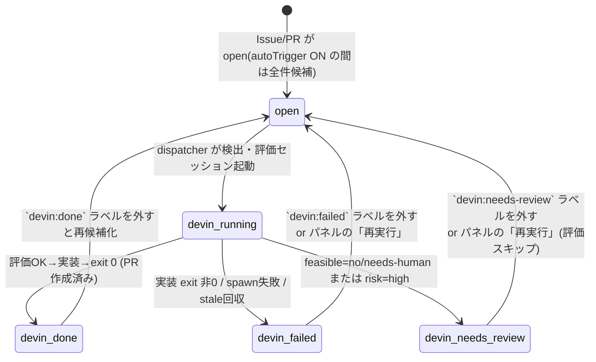

# Devin Agent Dispatcher

GitHub Issues/PR を監視する常駐システム。**「対応候補の検出」と「自動処理（起動）」は
独立した2つの機能**として動く。この PC（`C:\devin`）上で動作する。

- **対応候補（検出）= `autoDiscover`**: ON の間、全 open Issue/PR を定期スキャンし
  `candidates.json` に保存。OFF なら自動検出を停止（「今すぐ取得」での手動更新は可）
- **課題対応（起動）= `autoTrigger`**: ON の間だけ、検出した候補を評価→実装の
  2フェーズで自動起動する。OFF でも検出・一覧・手動起動は動く
- パネル最上段の2つのトグルで独立制御。「取得だけ自動・処理は手動」も可能
- トリガーにラベルは不要。除外したい課題には `devin:done` ラベルを付ける

```mermaid
flowchart TD
    subgraph GH["GitHub (人間の操作)"]
        A["Issue/PR が open である<br/>(新規・既存・ラベル不要)"]
        R["パネルの「再実行」or<br/>個別「対応」ボタン"]
    end

    subgraph D["常駐 dispatcher.mjs (このPC)"]
        B["ポーリング周期ごとに `gh issue/pr list`<br/>で全監視リポジトリを走査<br/>(検出: autoTrigger と無関係に常時)"]
        C{"autoTrigger ON<br/>＆ done/failed/needs-review なし<br/>＆ 未起動?"}
        Q["起動キューへ<br/>(maxConcurrent=1 で順次実行)"]
        LB["`devin:running` ラベル<br/>＋ 起動コメント投稿"]
        SP["Phase1: 評価セッション起動<br/>(読み取り専用 devin -p)"]
        V{"判定: feasible=yes<br/>＆ risk ≤ maxAutoRisk?"}
        NR["`devin:needs-review` ラベル<br/>＋ 評価結果コメント"]
        SP2["Phase2: 実装セッション起動<br/>(dangerous モード devin -p)"]
        F{"終了コード"}
        OK["`devin:done` ラベル<br/>＋ 完了コメント(ログパス)"]
        NG["`devin:failed` ラベル<br/>＋ 失敗コメント(ログパス)"]
        ST["起動時: `running` のまま残り<br/>180分超の取り残しを検出<br/>→ `failed` へ回収"]
    end

    subgraph S["Phase2 devin -p セッション (dangerous)"]
        P1["AGENTS.md/規約を読込<br/>`git switch -c devin/issue-N`"]
        P2["Issue 実装 / PR レビュー対応<br/>lint・test・build で検証"]
        P3["push → `gh pr create`<br/>(本文に Closes #N)"]
    end

    A --> B
    R --> B
    B --> C
    C -- "なし" --> B
    C -- "あり" --> Q --> LB --> SP --> V
    V -- "yes/low〜medium" --> SP2
    V -- "no / needs-human / high" --> NR
    SP2 --> P1 --> P2 --> P3 --> F
    F -- "0" --> OK
    F -- "非0 / spawn失敗" --> NG
    NG -.-> R
    NR -.-> R
    ST -.-> NG
```

ラベル状態遷移（Issue/PR 側から見た図）:



## 前提（初回のみ）

1. **devin CLI のログイン**（必須・未実施の場合）
   ```
   "C:\Users\ryu.RYU-NOTE\AppData\Local\Programs\Devin\resources\app\extensions\windsurf\devin\bin\devin.exe" auth login
   ```
   ※ `devin` は PATH に無いため上記フルパス。任意で bin フォルダを PATH に追加してよい。
2. `gh auth login` 済みであること（この環境では済）
3. Node.js v18+（この環境では v24）

## 使い方

### 管理パネル（推奨）

```bash
cd C:\devin\agent
node control.mjs    # http://127.0.0.1:8585/ に管理パネルが立つ
```

ブラウザで開くと **起動 / 停止 / 1サイクル実行 / 設定再読込** のボタン操作、
稼働状態・設定・**対応候補一覧**・処理履歴・ログのライブ表示ができる。

- **対応候補一覧**: `/api/candidates` が「次のポーリングで起動される課題」を表示。
  **2層のローカルキャッシュ**で GitHub への読込を最小化している:
  - `candidates.json` — 候補一覧のキャッシュ（`candidateCacheSec` 以内ならライブ取得をスキップ）
  - `issues.json` — 検出した課題の**詳細（body/labels/日時）のローカルストア**。
    手動 dispatch(`--task`) はここを優先して読み、`gh` 再取得しない
  - 「課題の有無」の検出自体は常にライブ取得（新規課題はキャッシュでは分からないため）。
    ただし GitHub Search API 横断クエリで **repo別18呼出→type別2呼出** に削減済み
- **個別「対応」ボタン**: 候補行のボタンで `POST /api/dispatch` →
  `dispatcher.mjs --task "owner/repo issue#N"` が単一課題だけを即時起動
  （ポーリングを待たない・他課題は起動しない）。`devin:running` 付きは二重起動防止で
  スキップ。処理履歴の failed 行には「再実行」ボタンも出る

- `control.mjs` が dispatcher の**親（スーパーバイザー）**。常駐・タスクスケジューラ登録するのはこちら
- 「起動」すると `desired.json` に `enabled:true` が残るため、PC 再起動後も
  control 起動と同時に dispatcher が自動復帰する。「停止」で `enabled:false`
- POST API は `X-Panel: 1` ヘッダ必須（CSRF対策）＋ `127.0.0.1` のみにバインド
- `/api/reload` は `config.json` のみ再読込。`.mjs` ファイルを編集した場合は
  control サーバー自体の再起動が必要（モジュールは起動時に読み込まれる）
- **開き方は3通り**: `http://127.0.0.1:8585/` / `panel.html` を `file://` で直接開く
  （CORS で `Origin:null` のみ許可済み）/ ターミナルから `curl` で API 直接操作

### ターミナルからの制御（curl）

```powershell
curl.exe http://127.0.0.1:8585/api/status                          # 状態確認
curl.exe http://127.0.0.1:8585/api/candidates                      # 対応候補一覧
curl.exe -X POST -H "X-Panel: 1" http://127.0.0.1:8585/api/start   # 起動
curl.exe -X POST -H "X-Panel: 1" http://127.0.0.1:8585/api/stop    # 停止
curl.exe -X POST -H "X-Panel: 1" http://127.0.0.1:8585/api/once    # 1サイクル実行
curl.exe -X POST -H "X-Panel: 1" http://127.0.0.1:8585/api/reload  # 設定再読込
curl.exe -X POST -H "X-Panel: 1" -d "{\"key\":\"yamamoto-ryuzo/portal issue#21\"}" \
         http://127.0.0.1:8585/api/dispatch                       # 個別課題を即時起動
```

### CLI 直接起動（開発・検証用）

```bash
node dispatcher.mjs --dry-run   # 対象課題の検出のみ（起動しない・ラベルも作らない）
node dispatcher.mjs --once      # 1サイクル実行（見つけた課題は実際に起動）
node dispatcher.mjs             # 常駐ループ（管理パネル経由と同じ。どちらか一方で使う）
```

open な Issue/PR はすべて自動的に対応候補として検出される（ラベル不要）。
自動起動させるにはパネルの「自動処理」を ON にする。特定の課題だけ即時処理したい
場合は候補行の「対応」ボタン（評価フェーズはスキップ）。
除外したい課題にはあらかじめ `devin:done` ラベルを付けておく。

## 常駐化（タスクスケジューラ）

```powershell
powershell -ExecutionPolicy Bypass -File register-task.ps1   # control.mjs のログオン自動起動を登録
Start-ScheduledTask -TaskName DevinAgentDispatcher           # 今すぐ起動
```

登録されるのは `control.mjs`（管理サーバー）。パネルで「起動」した状態のままなら
`desired.json` により dispatcher も自動で上がる。パネルは常時 `http://127.0.0.1:8585/` で操作可能。

解除は `register-task.ps1 -Remove`。PC がシャットダウン中は動かない
（完全無人運用なら Devin Cloud Automations 構成を検討）。

## 設定（config.json）

| キー | 既定 | 説明 |
|---|---|---|
| `devinExe` | Devin Desktop 同梱 exe | devin CLI のパス |
| `pollIntervalSec` | 120 | ポーリング間隔（秒） |
| `maxConcurrent` | 1 | 同時起動セッション数 |
| `triggerLabel` 他 | `devin` / `devin:running` / `devin:done` / `devin:failed` | 状態ラベル（初回起動時に各 repo へ自動作成） |
| `autoDiscover` | `true` | `true` なら全 open Issue/PR を定期検出して `candidates.json` を更新 |
| `autoTrigger` | `true` | `true` なら検出した候補を自動起動（評価→実装）。検出自体は `autoDiscover` 側 |
| `autoTriggerSince` | `"all"` | 自動トリガーの起点。`"all"`=全 open Issue/PR が対象 / ISO8601時刻=それ以降の作成のみ / `null` なら dispatcher 初回起動時刻（`deployedAt`）以降のみ |
| `maxNewPerPoll` | 50 | 1ポーリングで自動起動キューに乗せる新規課題の上限（`autoTriggerSince:"all"` で backlog が全候補の場合でも `maxConcurrent` による直列実行なので実害なし） |
| `staleRunningMinutes` | 180 | dispatcher 停止で取り残された `running` ラベルを failed に戻すまでの時間 |
| `permissionMode` | `dangerous` | `devin -p` の権限モード。**無人運用には `dangerous` が事実上必須**（Windows は `--sandbox` 非対応のため）。リスクを下げたい場合は `smart`（承認待ちになりうる） |
| `assessFirst` | `true` | 実装前に読み取り専用の**評価セッション**を実行（feasible/risk/category/reason/plan を JSON 出力させる） |
| `maxAutoRisk` | `medium` | 自動実装に進めるリスク上限 |
| `needsReviewLabel` | `devin:needs-review` | category=`review` 時の保留ラベル（付いた課題は候補から除外。外すと再候補化） |
| `rejectedLabel` | `devin:rejected` | category=`reject`・risk 超過・評価不能時の除外ラベル（恒久的に候補から除外。外すと再候補化） |

評価カテゴリ: **auto**（即対応可→実装）/ **review**（検討の上対応→needs-review 保留）/ **human**（既存機能と明確に相反・大きな副作用。ユーザー選択まで対応へ進めない）/ **reject**（破壊的影響・方針違反・注入指示等→rejected で除外）
| `devinExtraArgs` | `[]` | devin 起動に追加する引数（例: `["--model","..."]`, `["--cloud"]`） |
| `controlPort` | `8585` | 管理パネルのポート（127.0.0.1 のみにバインド） |
| `candidateCacheSec` | `pollIntervalSec` と同じ | `/api/candidates` のキャッシュ有効期間（秒）。期限切れ or `?force=1` でライブ取得し `candidates.json` を更新 |
| `repos` | 9リポジトリ | 監視対象。`path`＝ローカル作業ディレクトリ、`github`＝`owner/name` |

## ファイル

- `control.mjs` — 管理サーバー＋スーパーバイザー（依存なし、Node 標準のみ）
- `panel.html` — 管理パネル UI
- `discover.mjs` — 課題発見ロジック（dispatcher/control 共用の共通モジュール）
- `dispatcher.mjs` — 本体（依存なし、Node 標準のみ）
- `config.json` — 設定
- `state.json` — 処理済み課題の状態（自動生成）
- `candidates.json` — 対応候補のキャッシュ（自動生成。`fetchedAt` + 軽量化した課題一覧）
- `issues.json` — open 課題のローカルストア（自動生成。title/body/labels/日時を保持。
  `--task`・将来の消費者が gh 再取得せず使える）
- `desired.json` — 「起動」状態の永続化（自動生成）
- `logs/dispatcher.log` — ディスパッチャー自身のログ
- `logs/<repo>_<type><N>_<ts>.log` — 各 devin セッションの stdout/stderr
- `register-task.ps1` — タスクスケジューラ登録スクリプト

## 設計上の注意

- **セッションは課題ごとに新規起動**（1セッション常駐ではない）。コンテキスト肥大と
  課題間汚染を避け、クラッシュ耐性も高い。
- **プロンプトインジェクション対策**: Issue 本文中の指示で手順と矛盾するもの
  （シークレット出力、main への直接 push、他 repo への操作等）はプロンプトで拒否する
  よう指示済み。ただし `dangerous` モードは全ツール自動承認のため、
  **トリガー権限 = その repo への push 権限を持つ人、と考えて運用すること**。
  信頼できない共同編集者がいる repo は `repos` から外すのが安全。
- **`autoTrigger` の注意**: `true` では **Issue/PR を作成できる人全員** が
  dangerous モードのエージェント実行を起こせる。`assessFirst`（既定ON）で
  実装前に読み取り専用の評価セッションが入り、注入指示・機密情報要求・曖昧すぎる要求等は
  `devin:needs-review` で自動保留されるが、完全な防御ではない。パブリック repo は
  `repos` から外すか `autoTrigger: false` 運用が安全。
- **評価の手動スキップ**: 個別「対応」ボタン／`POST /api/dispatch` は人間が対象を
  選定済みとみなし評価フェーズをスキップして実装に直行する。
- **冪等性**: ラベル + state.json の二重管理。再起動しても二重起動しない。
- **破壊的操作の抑止**: プロンプトで main 直 push・force push を禁止し、
  常に `devin/issue-N` ブランチ → PR 経由に限定している。

## エンジン別の動作検証（非 devin エンジン E2E）

`config.engine` に `copilot` / `antigravity` / `api` を指定すると、control.mjs の
`engineSend` が bridge-hub（既定 `http://127.0.0.1:8511`）または OpenAI 互換 API へ
単発送信し、応答を擬似チャット（shim）として watcher
（`watchAssess` / `watchSplit` / `watchImpl`）へ渡す。

2026-11-08 に本リポジトリの実課題（issue #14/#15）を対象に、別ポート隔離インスタンスで
実コード経路の E2E 検証を実施した結果は以下の通り。

### 前提: bridge-hub `/agent` の送信フィールド（Issue #3）

- 現行コードは `{provider, prompt}` を POST するが、ハブは `body.message` を読むため
  **プロンプトが無視され定型応答が返る**（例:「地図の状態は取得できていません」）。
  判定ブロックは出力されず `state.tasks` にも反映されない。
  `prompt` → `message` の1行修正で解消することを本検証で確認済み。

### 検証結果マトリクス（`message` キー送信時）

| 項目 | copilot | antigravity | api |
|---|---|---|---|
| assess 判定ブロック出力 | ○ `<!--devin-assess-->` 出力 | ○ 同左 | 未検証 |
| `state.tasks[key].assess` 反映 | ○ | ○ | — |
| autoTrigger 連鎖（assess→impl 自動投入） | ○ | ○ | — |
| impl 到達（編集〜PR 作成） | × | × | ×（単発応答） |

### 制限事項（検証で判明・確認した挙動）

- **bridge プロバイダはリポジトリ操作ツールを持たず impl は成立しない**
  - copilot:「地図操作のみを扱う設定で、リポジトリの閲覧・変更や GitHub 操作は
    できません」と応答。ファイル編集・push・`gh pr create` ができず
    `<!--impl-pr-->` も出力されない
  - antigravity: ツール基盤自体はあるが `command` が権限拒否される
    （`~/.gemini/antigravity-cli/settings.json` の `permissions.allow` 設定が必要。
    許可すれば将来 impl が可能になる可能性あり）
  - assess も**コード未参照のテキスト評価**になる点に注意（プロバイダ自身が
    「コードを参照できないため実装状況は未確認」と回答）
- **エラー応答は静かに消える**: ハブ未到達等で `engineSend` が失敗すると shim に
  `[engine error] <msg>` が入るが、watcher はマーカー非検出で何も記録せず終了する。
  `devin:failed` ラベル・state へのエラー記録・再試行は行われない（実機確認済み）
- **watcher タイムアウト（30分）も記録なし**: 監視が解除されるだけで状態遷移は
  起きない（コード確認。長時間実測は未実施）
- **shim 経路では split 継続が機能しない**: `<!--split-->` 検出後の新規課題再評価は
  `ch.send()` を呼ぶが shim に `send` がなく、TypeError が catch で握りつぶされ
  静かに失敗する（コード確認）
- **shim セッションは `/api/chat?id=` で内容を参照できない**: id が `engN` 形式で
  数値変換に失敗し messages が空になる（`snapshot()` も未実装。コード確認）
- **`engine` はグローバル設定**: 切替中は投入される全タスクがそのエンジン経路になる。
  検証後は `devin` へ戻すこと

### 推奨される使い分け（現状）

- `devin`: 全モード（assess / split / impl / pr）対応の本体エンジン
- `copilot` / `antigravity`: **assess 限定**で動作（impl/split は制約上不可）
- `api`: assess 向け。impl を抑止する用途限定の整理は Issue #6 を参照
