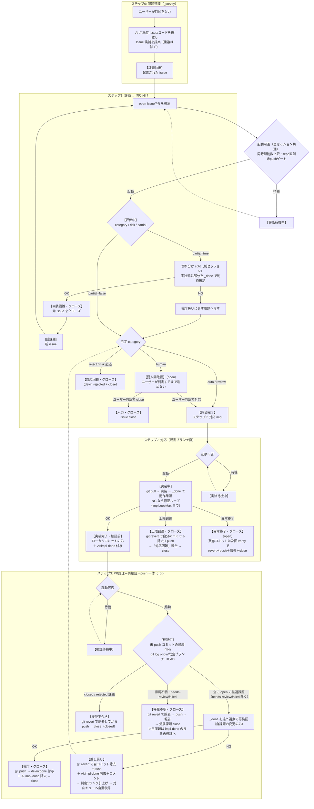

# 全体フロー（全モード共通）

課題対応の基本の流れ。各ステップは**それぞれ別セッション**が担当し、モード別の詳細は
`_survey`/`_assess`/`_split`/`_impl`/`_pr`/`_done` を参照。

## 各ステップの要点

- **ステップ0**: 目的が無い場合もリポジトリの現状から改善・修正候補を抽出して課題化してよい。起票はユーザー操作（AI は候補の提案まで）
- **ステップ1**: 評価は**判定のみ**（issue 操作・コード変更はしない）。`partial=true` は切り分けセッションへ引き渡す。新規 `[残課題]` issue は検出されて同じフローを回る（切り分けの再帰）
- **ステップ2**: ブランチは切らず既定ブランチで直接作業。push・PR・ブランチ作成は禁止
- **ステップ3**: 「PR処理」= リモートへのコミット（push）。GitHub PR は作らない。検証 NG は差し戻しのみ（修正は次の対応セッションが新規コミットで行う）

## 常に守ること

- 「実装済み」「完了」は**動作確認の証拠**がある場合のみ使う（憶測で完了にしない）
- 検証ができない環境制約では、未確認の内容を明記して `needs-review` 扱いにする
- 実装セッションは原則 **push しない**（ローカルコミットまで）。リモートへの push は再検証ステップ専用——ただし「対応困難」で断念する時のみ、自分のコミットを revert 除去した後の `git push` は許可する（除去をリモートへ反映して滞留させないため）
- **起動可否は全セッション（評価・対応・再検証）共通**で dispatcher が判定する——同時起動数上限・リポジトリ単位直列・未 push ゲートで落ちた課題は「評価待機中」として次ポーリングで再判定される
- force push・既存データの削除は明示許可がある場合のみ
