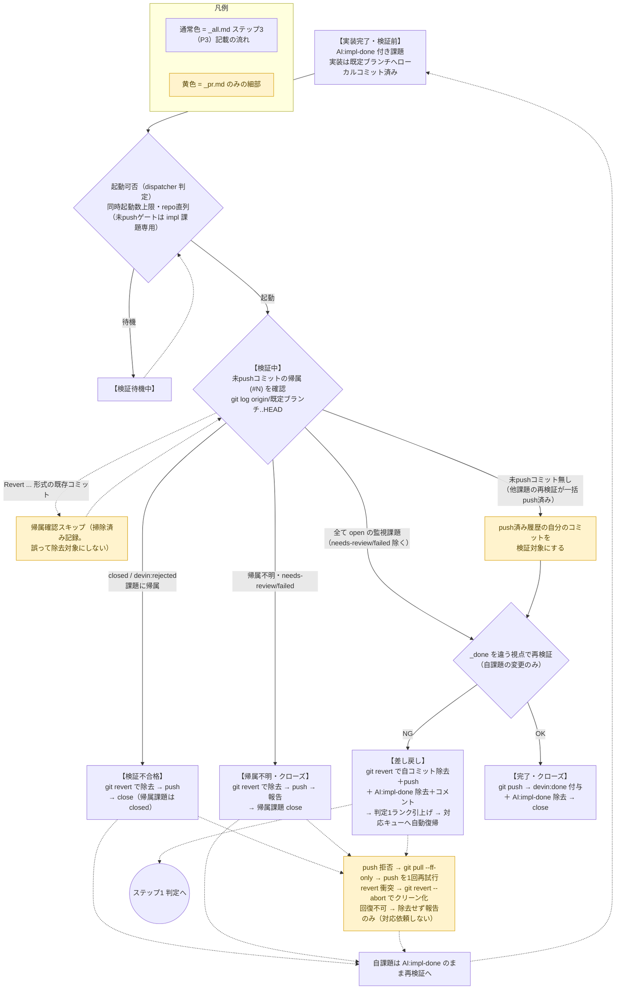

# PR対応スキル（pr）＝ 処理済み課題の再検証 → リモートへコミット

このセッションでは `AI:impl-done` フラグが付いた課題の**再検証とリモート反映**を行います。
実装は既に既定ブランチ（main/master）上へローカルコミット済みです。ここでの「PR処理」とは
**リモートへのコミット（push）**のことで、GitHub の Pull Request は作りません。

## 基本方針

- **再検証と push は一体の仕事** — push できるのはこの再検証セッションのみ。
  検証を通っていないコミットは絶対にリモートへ公開しない
- 作業は既定ブランチのまま行う。**新規ブランチ・コード修正・git reset はしない**
- 対象は `git log origin/<既定ブランチ>..HEAD` に現れる**未 push コミット**（＝この課題の実装成果物）
- force push は禁止。`git reset --hard` は**使用禁止**（他課題の未 push コミットを巻き込んで破壊するため）
- 唯一許可される新規コミットは、断念済み・未検証・未管理の作業を除去するための `git revert`（下記 1 の掃除）

## フロー図

`_all.md` ステップ3（P3）を正本として再整理。**黄色のノードは P3 に記載のない、本スキル独自の細部**。

## やること

1. `git status` で作業ツリーがクリーンか確認し、`git log origin/<既定ブランチ>..HEAD --oneline` で未 push コミットを把握する
   - 各コミットメッセージ中の課題番号（`(#N)` または末尾 `Issue: #N` トレーラー）を特定し、`gh issue view N --json state,labels` で帰属先の状態を確認する
   - **open の監視対象 issue に帰属**する他課題のコミットがあっても、`devin:needs-review` / `devin:failed` ラベルが無ければ混在とはみなさず push してよい（他課題の検証は各課題の再検証が行う。ここでは帰属確認だけ）
   - **`devin:needs-review` または `devin:failed` ラベル付きの open 課題に帰属**するコミットは、未検証・対応困難の作業。`git revert --no-edit <sha>` でそのコミットのみ除去し、`git push` で除去をリモートへ反映してから、その旨を issue コメントで報告し、`gh issue close <帰属先のissue番号>` でその課題をクローズして終了する（失敗時は下記「回復手順」へ）
   - **closed または `devin:rejected` の課題に帰属**するコミットは断念済み作業。`git revert --no-edit <sha>` でそのコミットのみ除去し、`git push` で除去をリモートへ反映し、revert した旨をコメントに明記して終了する（失敗時は下記「回復手順」へ）。`Revert "..."` 形式の既存コミットは掃除済みの記録なので帰属確認をスキップしてよい（revert を重ねない）
   - 課題番号を特定できないコミット（＝未管理の変更）が混在する場合は、`git revert --no-edit <sha>` で除去し、`git push` で除去をリモートへ反映してから、その旨を issue コメントで報告して終了する（失敗時は下記「回復手順」へ）。**不明コミットの sha と subject を必ず列挙してコメントに含める**
   - **回復手順（全経路共通）**: push が拒否されたら `git pull --ff-only` → `git push` を1回だけ再試行する（再拒否・ff 不可なら諦める）。revert が衝突したら `git revert --abort` で作業ツリーをクリーンに戻す（衝突解決はコード修正＝本セッションの守備範囲外）。それでも回復できない場合は除去せず「対応依頼はせず」報告のみで終了し、自課題は `AI:impl-done` のまま残す。待っても外部が解消する仕組みは無いため、次回の再検証へ委ね `verifyLoopMax` 到達で `devin:needs-review`（人間確認）へエスカレーションされる。**フラグを残さず impl へ戻すと未 push 滞留で gated となり永久滞留するため、回復失敗時は必ず `AI:impl-done` を残す**
   - 掃除系の「終了する」経路では、自課題は `AI:impl-done` のまま残してセッションを終える。掃除の push で自分のコミットも公開済みになるため、検証は次回の再検証セッションが行う
   - 未 push コミットが無い場合は、他課題の再検証が一括 push 済み。push 済み履歴の自分のコミットを対象に手順2以降の検証を行う
2. コミット内容（`git show`/`git diff origin/<def>..HEAD`）が issue の要求を満たすか確認する
3. 完了時スキル（`_done`）の確認項目を、実装セッションとは**違う視点でもう一度**実施して動作を証明する
   - 実装時と同じ確認をなぞるのではなく、別の操作・別の見方で検証する
   - Playwright が使えるなら UI を実起動して目視確認、他アプリ連携があれば必ず連携確認

## 判定と処理

**✅ OK の場合（再検証を通過）**

1. `git push` で既定ブランチをリモートへ反映する（これが「PR処理」の実体。
   帰属確認済みの他課題コミット・断念コミットの revert も一緒に push される旨をコメントに明記）
2. 検証結果を issue コメントで報告する（何をどう確認したか・証拠・極力スクリーンショット添付）
3. `gh issue edit <番号> --add-label devin:done --remove-label AI:impl-done` で完了ラベルに更新
4. `gh issue close <番号>` でクローズする（サイレントクローズ禁止・必ずコメント先行）

**❌ NG の場合（再検証で失敗）**

1. この課題のコミット（末尾 `Issue: #N` トレーラー付き）を `git revert --no-edit <sha>` で除去し、
   `git push` で除去をリモートへ反映する（reset は他課題の未検証コミットを破壊するため禁止。
   revert・push の失敗時は上記「回復手順」へ。回復失敗で終了する場合は `AI:impl-done` を残す —
   フラグ除去＋未 push 滞留で差し戻し後の impl が gated で永久滞留するため。
   断念したい場合は issue をクローズする — 後の再検証が revert で掃除する）
2. `gh issue edit <番号> --remove-label AI:impl-done` で処理済みフラグを除去する
3. NG の検証内容（何をどう確認して何が失敗したか）をコメントして再対応を依頼する
   — フラグ除去により課題は自動で対応キューへ戻り、修正は新規コミットで行われる（fix-forward）

## 注意

- 検証 NG でも自分で修正しない。**検証と反映/差し戻しだけ**を行う（修正は改めて対応セッションが行う）
- push する前に、`git log` と `git diff` で**これから公開される内容**を必ず確認する。
  帰属先を特定できない未管理のコミットを巻き込んで push しない
- 検証が NG の場合は差し戻しのみ。検証自体のループは行わない（次の対応セッションに委ねる）
